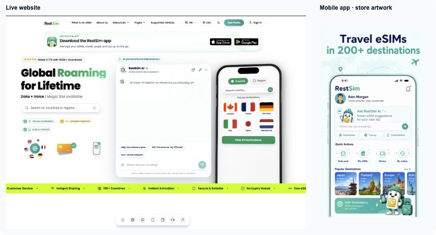
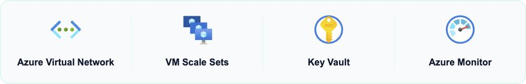
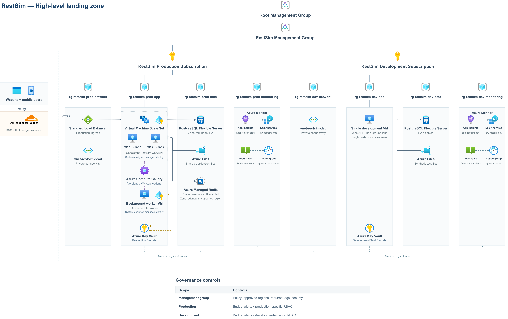
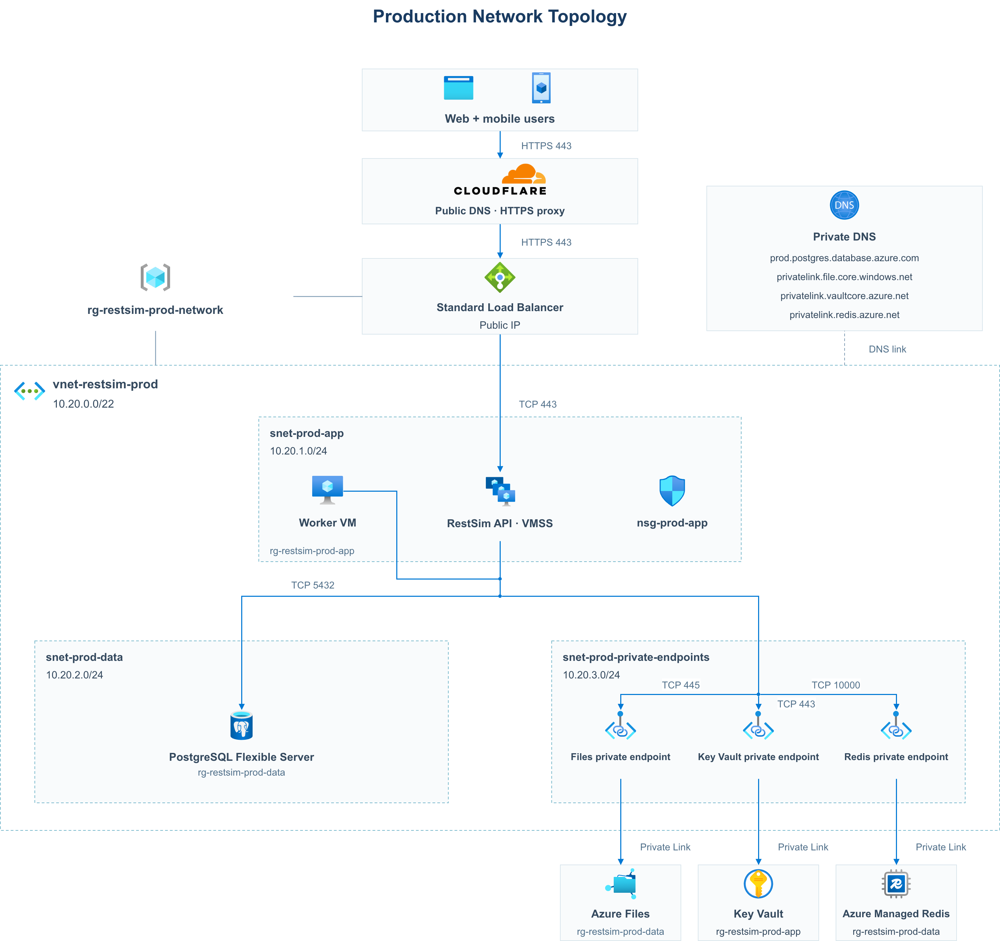
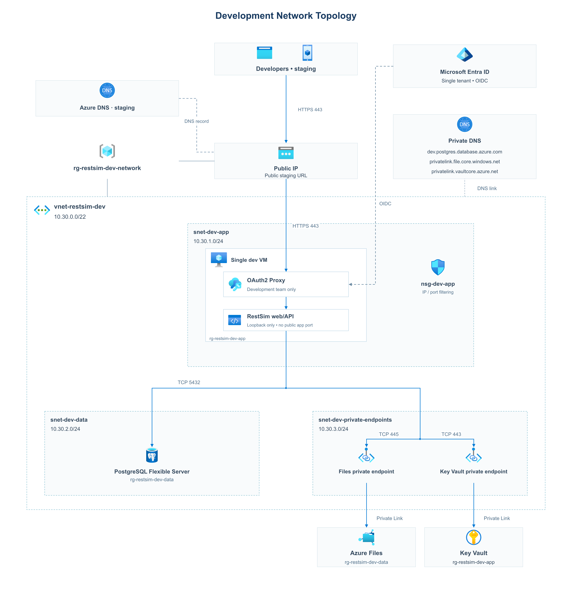
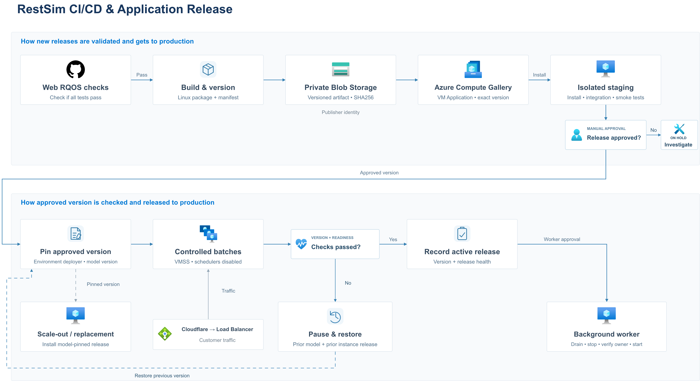
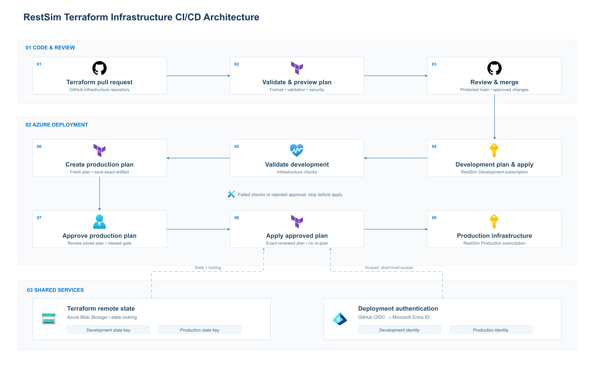
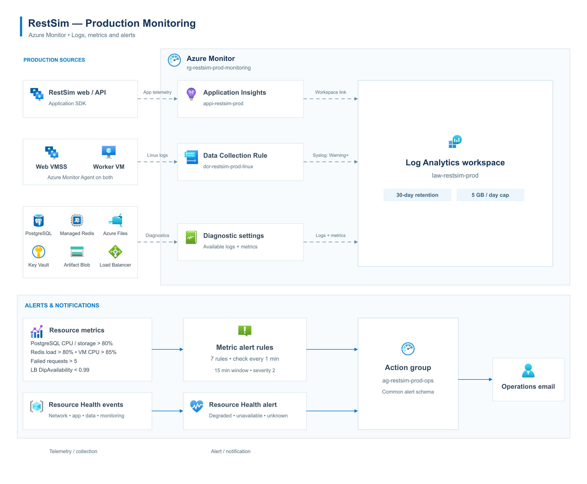
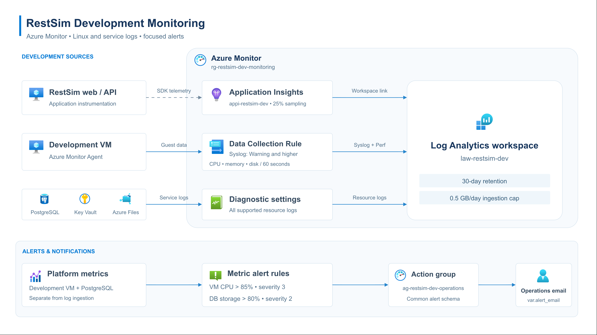

## Business Context

[RestSim](https://restsim.com) is a travel eSIM platform that helps travelers stay connected abroad with mobile data, calls and SMS, depending on the plan. Customers can browse destinations, buy plans and manage their eSIMs through the website and mobile apps. It started with a small user base and now serves a growing number of users.

| Website | iOS app | Android app |
| :---: | :---: | :---: |
|  |  |  |

I translated RestSim's single-server requirements into an Azure architecture, separate production and development Terraform configurations, and an itemised cost model.

**Contents:** [Business problem](#business-problem) · [My contribution](#my-contribution) · [Landing zone](#landing-zone) · [Architecture diagrams](#architecture-diagrams) · [Design guides](docs/architecture/README.md) · [Implementation](#implementation) · [Cost review](docs/costs/README.md)

## Business problem

RestSim runs on one VPS to keep costs low, but relying on one server creates a risk of downtime and limits how the application can handle growing traffic. With customers around the world, reliable access and fast response times across regions also matter.

## My contribution

I studied RestSim's current infrastructure and researched improvements based on its application requirements. I turned those requirements into an Azure architecture and separate production and development Terraform configurations, focusing on reducing dependence on one server, protecting application data and making infrastructure changes repeatable without unnecessary cost.

- **Architecture:** I mapped the single-server risks to a web scale set, a separate worker and shared database, file and session services.
- **Infrastructure as code:** I wrote production and development Terraform configurations for networking, compute, private services, identity, monitoring and recovery.
- **Security:** I defined subnet and NSG rules, private service connections, managed identities and scoped secret access.
- **Release design:** I mapped the existing application checks into a versioned-package flow, with staging, controlled rollout and a separate worker handover.
- **Cost analysis:** I calculated 52 cost lines from Microsoft retail rates and compared the smaller development footprint with the production configuration.
- **Technical documentation:** I created seven draw.io diagrams and guides explaining the resource relationships and engineering decisions.

View the live RestSim product

## Landing zone

I started with the landing zone to map where resources belong before writing Terraform. The design separates environments and groups resources by network, application, data and monitoring, with access controls and governance around them.

[Open full-size architecture](https://viewer.diagrams.net/?nav=1&title=RestSim%20Azure%20Architecture&page-id=_U4szGZBWyCFBpTj2Gg4#Uhttps%3A%2F%2Fraw.githubusercontent.com%2Fisraad-visuals%2Frestsim-azure-infrastructure%2Fmain%2Fdocs%2Farchitecture%2FRestSim-Azure-Architecture.drawio)

Production uses multiple application instances with shared data services and a separate background worker. Development gives developers an isolated, smaller environment to test and stage application changes before a production release. Managed identities, Key Vault and central monitoring support both access control and operations.

[Read the landing-zone decisions: resource ownership, reliability, governance and cost](docs/architecture/01-landing-zone.md).

## Architecture diagrams

[View the seven-page architecture](https://viewer.diagrams.net/?nav=1&title=RestSim%20Azure%20Architecture#Uhttps%3A%2F%2Fraw.githubusercontent.com%2Fisraad-visuals%2Frestsim-azure-infrastructure%2Fmain%2Fdocs%2Farchitecture%2FRestSim-Azure-Architecture.drawio)

| Design | What it explains | Detailed page |
| --- | --- | --- |
| [Landing zone](#landing-zone) | Resource organisation, availability, governance and cost. | [Details](docs/architecture/01-landing-zone.md) |
| [Production network](#production-network) | Customer traffic, subnets and private service access. | [Details](docs/architecture/02-production-network.md) |
| [Development network](#development-network) | Isolated developer testing and staging. | [Details](docs/architecture/03-development-network.md) |
| [Application CI/CD](#application-cicd) | Versioned packages, controlled rollout and recovery. | [Details](docs/architecture/04-application-cicd.md) |
| [Terraform CI/CD](#terraform-cicd) | Infrastructure review, state and deployment identity. | [Details](docs/architecture/05-terraform-cicd.md) |
| [Production monitoring](#production-monitoring) | Telemetry, alerts and operational response. | [Details](docs/architecture/06-production-monitoring.md) |
| [Development monitoring](#development-monitoring) | Development logs, resource metrics and email alerts. | [Details](docs/architecture/07-development-monitoring.md) |

## Production network

I kept Cloudflare as RestSim's public entry point and placed Standard Load Balancer in front of the VMSS to spread requests across healthy web instances. The application and worker use private connections to PostgreSQL, Files, Redis and Key Vault. Separate subnets and NSG rules control the permitted paths.

[Design details](docs/architecture/02-production-network.md) · [Open full-size diagram](https://viewer.diagrams.net/?nav=1&title=RestSim%20Azure%20Architecture&page-id=FVyJa8Ms7tz5EjTs3-nd#Uhttps%3A%2F%2Fraw.githubusercontent.com%2Fisraad-visuals%2Frestsim-azure-infrastructure%2Fmain%2Fdocs%2Farchitecture%2FRestSim-Azure-Architecture.drawio) · [Back to diagram table](#architecture-diagrams)

## Development network

I designed development as the developers' isolated environment for testing and staging application changes before a production release. Separate networking, data and credentials keep it apart from production. Developers access the staging URL through Microsoft Entra ID and OAuth2 Proxy, while one VM keeps the development footprint smaller.

[Design details](docs/architecture/03-development-network.md) · [Open full-size diagram](https://viewer.diagrams.net/?nav=1&title=RestSim%20Azure%20Architecture&page-id=dXpRaSZKOgxavGIHGhGw#Uhttps%3A%2F%2Fraw.githubusercontent.com%2Fisraad-visuals%2Frestsim-azure-infrastructure%2Fmain%2Fdocs%2Farchitecture%2FRestSim-Azure-Architecture.drawio) · [Back to diagram table](#architecture-diagrams)

## Application CI/CD

I designed the Azure release path around RestSim's existing CI and RQOS checks. One versioned package moves through private Blob Storage, Compute Gallery and staging before controlled VMSS rollout. Exact version pins, a separate worker handover and a recovery path keep deployment decisions traceable.

[Design details](docs/architecture/04-application-cicd.md) · [Open full-size diagram](https://viewer.diagrams.net/?nav=1&title=RestSim%20Azure%20Architecture&page-id=dJ8D57PUJrwz-ndNujR8#Uhttps%3A%2F%2Fraw.githubusercontent.com%2Fisraad-visuals%2Frestsim-azure-infrastructure%2Fmain%2Fdocs%2Farchitecture%2FRestSim-Azure-Architecture.drawio) · [Back to diagram table](#architecture-diagrams)

## Terraform CI/CD

I separated infrastructure changes from application releases so each follows its own review process. The infrastructure workflow design uses Terraform plans and separate environment state. I keep each state file locally beside its environment configuration; GitHub OIDC provides scoped identities for the delivery design. A saved-plan approval step ties the production change to the configuration that was reviewed.

[Design details](docs/architecture/05-terraform-cicd.md) · [Open full-size diagram](https://viewer.diagrams.net/?nav=1&title=RestSim%20Azure%20Architecture&page-id=8nira5fFPzOVPsJZNsbC#Uhttps%3A%2F%2Fraw.githubusercontent.com%2Fisraad-visuals%2Frestsim-azure-infrastructure%2Fmain%2Fdocs%2Farchitecture%2FRestSim-Azure-Architecture.drawio) · [Back to diagram table](#architecture-diagrams)

## Production monitoring

I designed central monitoring to trace RestSim application failures across web instances and managed dependencies. Application Insights provides request and dependency telemetry, while Linux logs and Azure diagnostics feed Log Analytics. I defined metric and Resource Health alerts for operational notifications, with retention and ingestion limits to manage log volume and cost.

[Design details](docs/architecture/06-production-monitoring.md) · [Open full-size diagram](https://viewer.diagrams.net/?nav=1&title=RestSim%20Azure%20Architecture&page-id=ZR1PCFiNJjQxqDGBOhbM#Uhttps%3A%2F%2Fraw.githubusercontent.com%2Fisraad-visuals%2Frestsim-azure-infrastructure%2Fmain%2Fdocs%2Farchitecture%2FRestSim-Azure-Architecture.drawio) · [Back to diagram table](#architecture-diagrams)

## Development monitoring

I gave development its own monitoring workspace and notifications so developers can investigate application changes separately from production. Linux performance data and service logs feed Log Analytics, while CPU and database-storage alerts send email through the development action group. A 30-day retention period, 0.5 GB/day ingestion cap and 25% Application Insights sampling setting keep the collection footprint smaller.

[Design details](docs/architecture/07-development-monitoring.md) · [Open full-size image](docs/architecture/07-development-monitoring.png) · [Back to diagram table](#architecture-diagrams)

## Implementation

| Area | Repository contents |
| --- | --- |
| Infrastructure | Separate [production](terraform/environments/production/) and [development](terraform/environments/development/) Terraform configurations. |
| Architecture | Seven diagrams with network paths, identity boundaries, release flows and monitoring decisions. |
| Deployment controls | Separate local state, ignored environment inputs, SSH-key authentication and scoped deployment identities. |
| Cost planning | A [resource-by-resource cost review](docs/costs/README.md), calculation CSV and dated retail-rate snapshot. |
